<p align="center">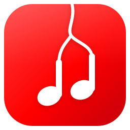</p>

<h1 align="center">YouTube Music Desk</h1>

Cliente desktop leve para o **YouTube Music** no Windows, feito com Rust + Tauri.
Abre rápido, usa pouca memória e quase nenhuma CPU em segundo plano.

> Projeto pessoal e não oficial, sem vínculo com o Google/YouTube. A reprodução usa o
> próprio `music.youtube.com`, com a sua conta.

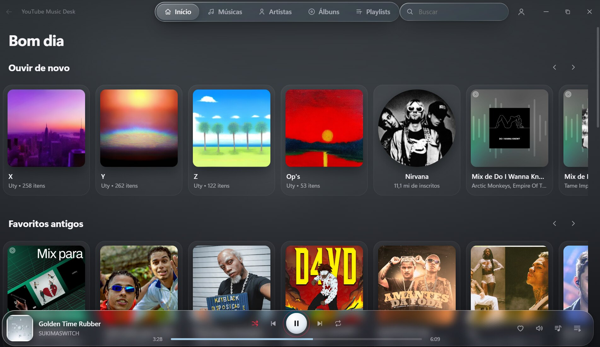

## Download

Baixe o instalador `*_x64-setup.exe` em
[Releases](https://github.com/amaytu/YoutubeMusicDesk/releases/latest).
Depois de instalado, o app avisa quando houver versão nova e se atualiza sozinho.

O instalador não é assinado: se o SmartScreen avisar, clique em
**Mais informações → Executar assim mesmo**.

## Recursos

- **Interface própria** com Início, Músicas, Artistas, Álbuns, Playlists e busca;
  responsiva até o tamanho de um celular.
- **Tocando agora** com a capa em tela cheia, fila, "A seguir" (Tudo, Conhecidas,
  Em alta, Descobrir) e letra.
- **Letra sincronizada** e **tradução para português** linha a linha, seguindo a música.
- **Playlists**: segure uma música e arraste até uma playlist; botão direito para
  adicionar, remover ou curtir; criar, renomear e excluir playlists.
- **Ilha dinâmica**: com o app em segundo plano, uma pílula no topo da tela mostra a
  música e a letra; passe o mouse para ver os controles.
- **Início personalizado**: botão direito → *Começar em…* para uma música sempre
  começar no tempo escolhido (ex.: "Time", do Pink Floyd, em 2:15).
- **Cores que acompanham a capa** da música tocando.
- **Teclas de mídia**, ícone na bandeja, iniciar com o Windows e modo economia.
- **Login com Google** em poucos cliques; a sessão fica salva.

| Letra | Letra traduzida |
|---|---|
| 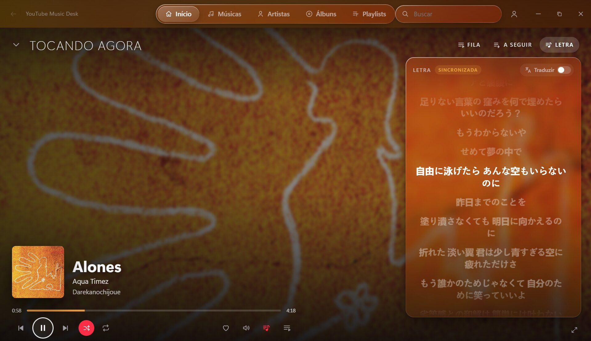 | 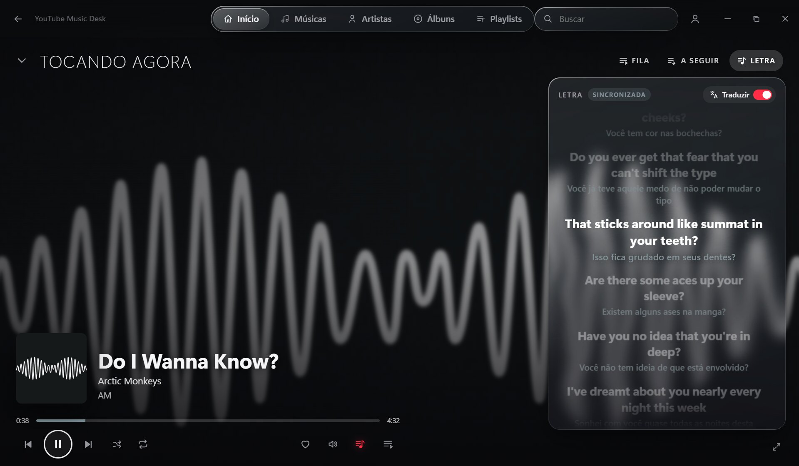 |

**Ilha dinâmica** (com o app em segundo plano)

| Compacta | Ao passar o mouse |
|---|---|
| 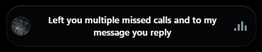 |  |

| Arrastar para uma playlist | Configurações |
|---|---|
| 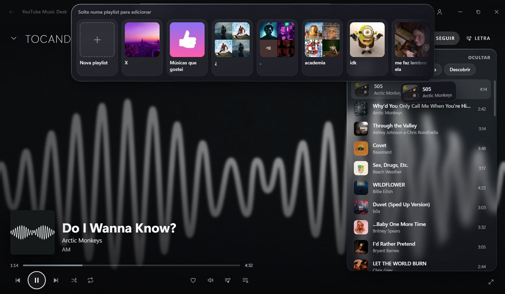 | 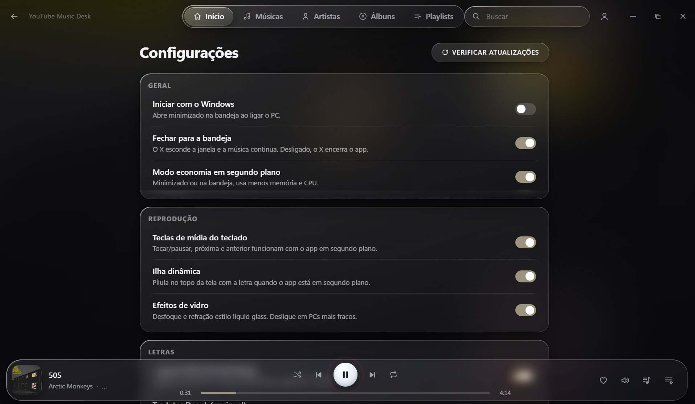 |

**Janela pequena**

| Início | A seguir | Letra | Configurações |
|---|---|---|---|
| 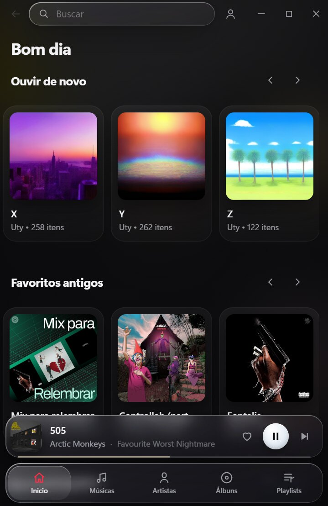 | 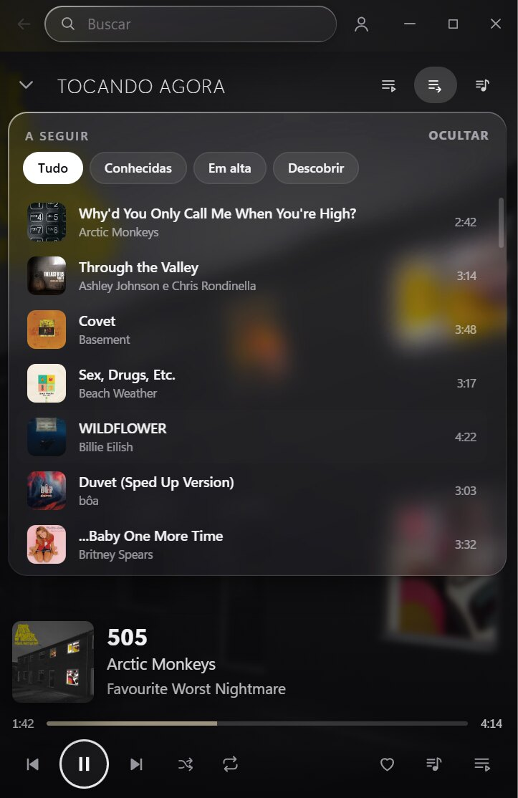 | 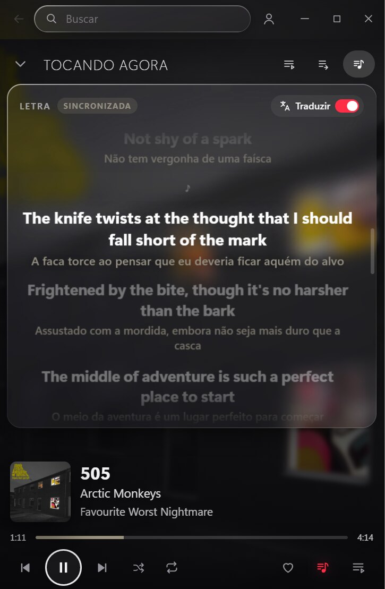 | 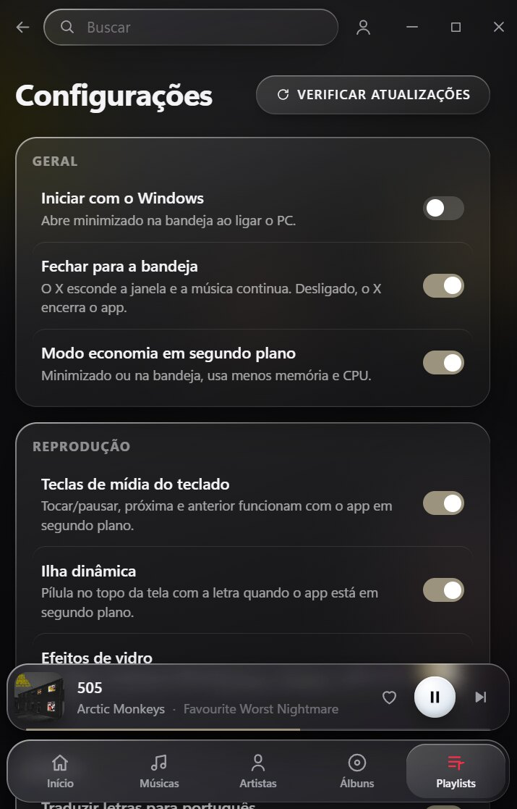 |

## Atalhos

| Tecla | Ação |
| --- | --- |
| `Espaço` | Tocar / pausar |
| `Ctrl + →` / `Ctrl + ←` | Próxima / anterior |
| `Ctrl + ↑` / `Ctrl + ↓` | Volume |
| `M` | Sem som |
| `L` | Curtir a música atual |
| `Ctrl + F` ou `/` | Buscar |
| `Ctrl + ,` | Configurações |
| `Alt + ←` | Voltar |
| `Esc` | Fechar o Tocando agora |

## Configurações

Ficam no ícone de conta → **Configurações** (ou no menu da bandeja). São salvas em
`%APPDATA%\com.amaytu.youtubemusicdesk\settings.json`. Para a tradução, o padrão é o
Google Tradutor; com uma chave do DeepL, ele passa a ser usado.

## Compilar

Pré-requisitos: [Rust](https://rustup.rs), [Node.js 22](https://nodejs.org) e o
[Visual Studio Build Tools](https://visualstudio.microsoft.com/visual-cpp-build-tools/)
(Desenvolvimento para desktop com C++).

```powershell
npm install
cargo install tauri-cli --version "^2" --locked

cargo tauri dev     # app completo
npm run dev         # só a interface no navegador, com dados de demonstração
cargo tauri build   # instaladores em src-tauri\target\release\bundle\
```

## Licença

MIT
