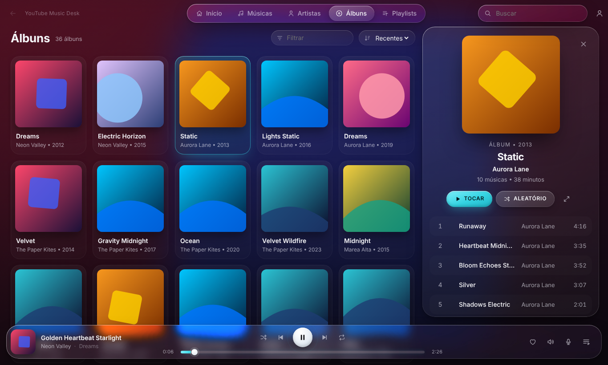
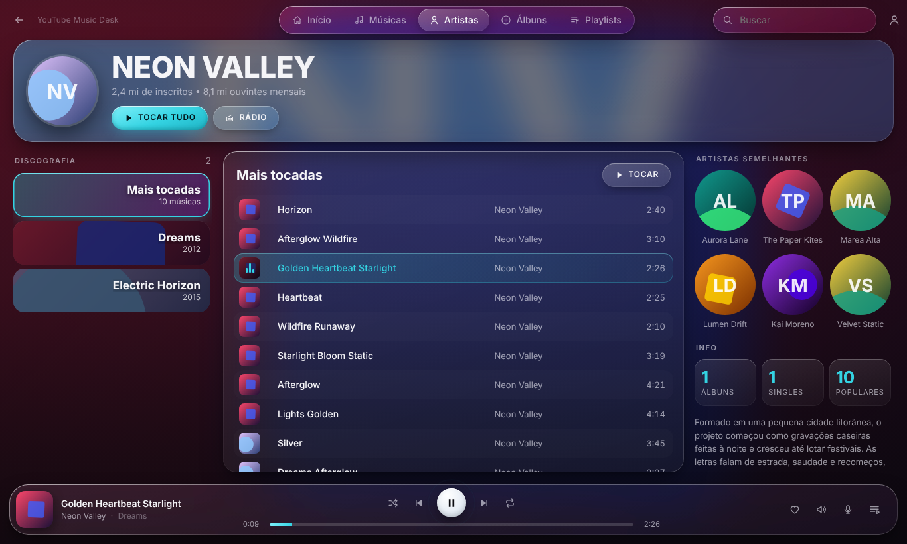
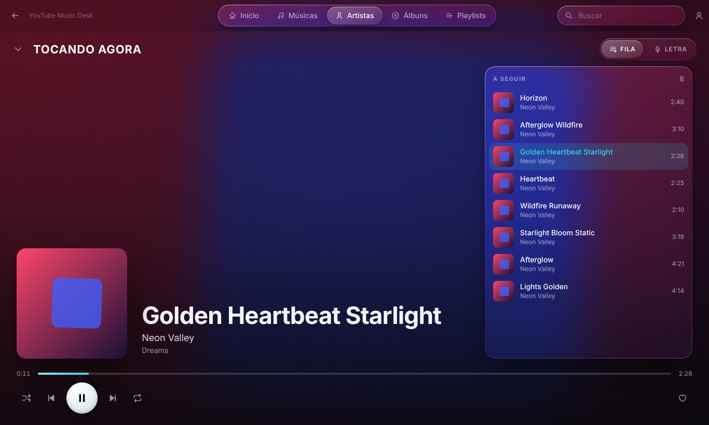

# YouTube Music Desk

Cliente desktop leve para o **YouTube Music** no Windows, feito em **Rust + Tauri v2**.
Inspirado no [spotifast](https://github.com/crmne/spotifast): foco em inicialização rápida,
pouca RAM e quase nenhum uso de CPU em segundo plano.

> Projeto não oficial, sem vínculo com o Google/YouTube. Usa o site oficial
> `music.youtube.com` — nada de API não documentada ou extração de streams.

| Álbuns | Artista | Tocando agora |
|---|---|---|
|  |  |  |

<sub>Capturas com dados de demonstração (`npm run dev`).</sub>

## Por que Tauri e não nativo como o spotifast?

O spotifast toca áudio nativamente via `librespot` porque o Spotify tem API de playback.
O YouTube Music não tem; um player nativo dependeria de engenharia reversa (quebra
com frequência e viola os termos). A alternativa mais leve e estável é o **WebView2**,
que já vem no Windows 10/11 e é compartilhado com o Edge — diferente do Electron,
que embute um Chromium inteiro por app.

| | Electron (ex.: th-ch/youtube-music) | YouTube Music Desk |
|---|---|---|
| Instalador | ~90 MB | ~3–5 MB |
| Processo host | ~80–150 MB | ~5–15 MB |
| Engine | Chromium embutido | WebView2 do sistema |

## Arquitetura

```
┌──────────────── janela "main" ────────────────┐      ┌──── janela "player" (oculta) ────┐
│ Interface própria (Svelte 5 + Vite)           │      │ music.youtube.com oficial        │
│ início, busca, biblioteca, artista, tocando   │◄────►│ toca o áudio + bridge.js         │
└───────────────────────────────────────────────┘ Rust └──────────────────────────────────┘
        invoke("ytm") ─► eval(__ymd.call) ─► API interna da página (/youtubei/v1)
        listen("ytm") ◄─ bridge_event (estado do player só quando muda)
```

- A **UI** é nossa: leve (≈110 KB de JS), fluida, com fundo desfocado da capa atual.
- O **áudio** continua vindo do player oficial do YouTube Music, numa janela oculta.
- Os **dados** (início, biblioteca, álbuns, artistas, letras) vêm da API interna que a
  própria página usa, com a sua sessão. Ela não é documentada: se o YouTube mudar o
  formato, os parsers em `src-tauri/src/bridge.js` precisam de ajuste.
- **Segurança**: a página do YouTube só pode chamar `bridge_reply`/`bridge_event`
  (ACL do Tauri em `capabilities/player.json`); a UI não acessa a página diretamente.

## Telas

- **Início**: escolhas rápidas e prateleiras de recomendações.
- **Busca**: melhor resultado, músicas, álbuns, artistas.
- **Biblioteca**: Músicas (lista com filtro/ordenação), Álbuns e Playlists (grade +
  painel lateral de faixas), Artistas.
- **Artista**: discografia | faixas do álbum selecionado | artistas semelhantes e info.
- **Tocando agora**: capa grande sobre fundo desfocado, com **Fila** e **Letra**.

Atalhos: `Espaço` tocar/pausar · `Ctrl+←/→` anterior/próxima · `Ctrl+F` ou `/` busca ·
`Alt+←` voltar · `Esc` fecha o "tocando agora".

## Design "liquid glass"

- **Material de vidro** (`.glass` em `src/app.css`): desfoque leve + refração SVG
  (`#lg-refract`, em `App.svelte`) + saturação, borda iluminada e brilho especular que
  segue o ponteiro (`use:sheen`).
- **Elementos flutuantes**: abas em cápsula com indicador "líquido" que desliza e estica;
  player em cápsula com o conteúdo rolando por baixo.
- **Transições** (View Transitions do WebView2): a página entra com fade + desfoque, a
  capa "voa" do card até a página do álbum/artista e da barra do player até o
  "Tocando agora".
- **Hover**: cards inclinam em 3D seguindo o mouse, botões com mola e reflexo,
  ícones com bolha de vidro, play em orbe com pulso enquanto toca.
- **Efeitos de vidro** pode ser desligado no menu da conta (PCs mais fracos);
  `prefers-reduced-motion` do Windows desliga as animações.

## Desempenho

- Dois webviews compartilham um único processo de navegador WebView2.
- Player oculto não renderiza nada; a UI só recebe eventos quando o estado muda
  (tempo de reprodução é interpolado localmente, sem tráfego por segundo).
- Miniaturas pedidas no tamanho exato; imagens `lazy`; listas longas renderizadas
  aos poucos com `content-visibility`.
- Modo economia em segundo plano (memória baixa do WebView2 + EcoQoS), bandeja,
  teclas de mídia globais, instância única e iniciar com o Windows.

## Login com o Google

Pensado para ser feito uma vez só, em poucos cliques:

1. Na primeira abertura sem conta, aparece **"Entrar com Google"** — um clique abre uma
   janela pequena direto na tela de login do Google.
2. E-mail → senha (ou passkey/Windows Hello) → a janela fecha sozinha e a biblioteca carrega.
3. A sessão fica salva no perfil do WebView2; nas próximas aberturas já entra logado.

"Explorar sem conta" esconde o convite por 7 dias. A qualquer momento, pelo ícone de conta ou pela bandeja:
**Entrar com Google / Trocar conta** ou **Sair da conta** (apaga cookies e dados do app).

**Sobre o bloqueio do Google:** o Google recusa login em navegadores embutidos
(WebView2 incluso) com a mensagem *"Este navegador ou app pode não ser seguro"*.
Para contornar, o app troca o user agent **apenas nas páginas de login** e restaura
o original ao voltar para `music.youtube.com`. Se ainda assim for recusado, aparece um
aviso com "Tentar de novo". Dá para trocar o UA usado no login em `login_user_agent`
ou desligar o recurso com `login_ua_switch: false`.

## Configurações

As opções do menu da bandeja são salvas em
`%APPDATA%\com.amaytu.youtubemusicdesk\settings.json`:

```json
{
  "close_to_tray": true,
  "economy_when_hidden": true,
  "media_keys": true,
  "user_agent": null,
  "extra_browser_args": null,
  "login_ua_switch": true,
  "login_user_agent": null
}
```

- `user_agent`: use se o login do Google disser que o navegador não é seguro.
- `extra_browser_args`: flags extras do WebView2, por ex. `"--renderer-process-limit=1"`
  para economizar ainda mais RAM (exige reiniciar o app).
- Ligar/desligar `media_keys` vale na hora; a flag que desativa o tratamento de teclas
  do próprio Chromium só muda ao reiniciar.

## Build

Pré-requisitos: [Rust](https://rustup.rs) (stable, MSVC), [Node.js 22](https://nodejs.org) e o
[Visual Studio Build Tools](https://visualstudio.microsoft.com/visual-cpp-build-tools/)
com "Desenvolvimento para desktop com C++".

```powershell
npm install
cargo install tauri-cli --version "^2" --locked

cargo tauri dev     # app completo com hot reload da UI
npm run dev         # só a UI no navegador, com dados de demonstração
cargo tauri build   # instaladores em src-tauri\target\release\bundle\
```

O GitHub Actions (`.github/workflows/build.yml`) compila a cada push na `main` e
publica um release ao criar uma tag `v*`.

## Estrutura

```
src/                       interface (Svelte 5)
  App.svelte               layout: barra superior, conteúdo, player, tocando agora
  views/                   Home, Search, Songs, Albums, Artists, Playlists, Artist, Collection
  components/              PlayerBar, NowPlaying, TitleBar, Card, Shelf, TrackList...
  lib/api.ts               chamadas ao Rust (ou mock.ts no navegador) + cache
  lib/player.svelte.ts     estado do player
src-tauri/
  src/bridge.js            roda na página do YT Music: API interna, parsers, player
  src/bridge.rs            ponte UI <-> página (chamadas com id, eventos)
  src/window.rs            janelas main/player, flags do WebView2
  src/login.rs             login do Google (UA só no login)
  src/tray.rs, media.rs, power.rs, settings.rs
  capabilities/            ACL: o que cada janela pode chamar
```

## Roadmap

- [ ] Mini player compacto sempre no topo
- [ ] Adicionar à fila / tocar a seguir, criar e editar playlists
- [ ] Cor de destaque extraída da capa
- [ ] Discord Rich Presence ("Ouvindo ...")
- [ ] Integração com SMTC (overlay de mídia do Windows e tela de bloqueio)
- [ ] Atalhos configuráveis
- [ ] Atualização automática (tauri-plugin-updater)

## Licença

MIT
